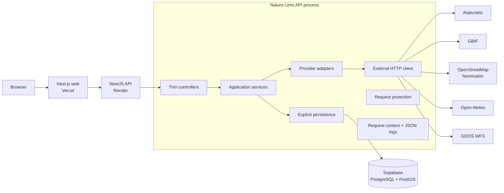
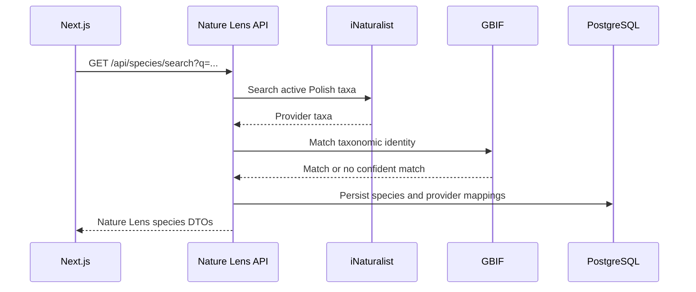
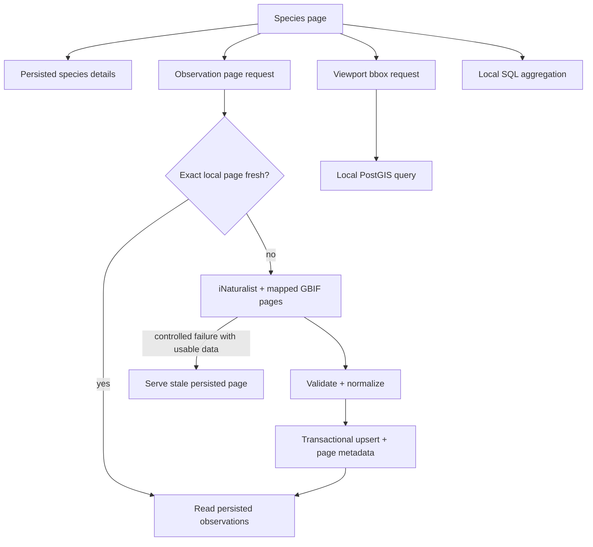
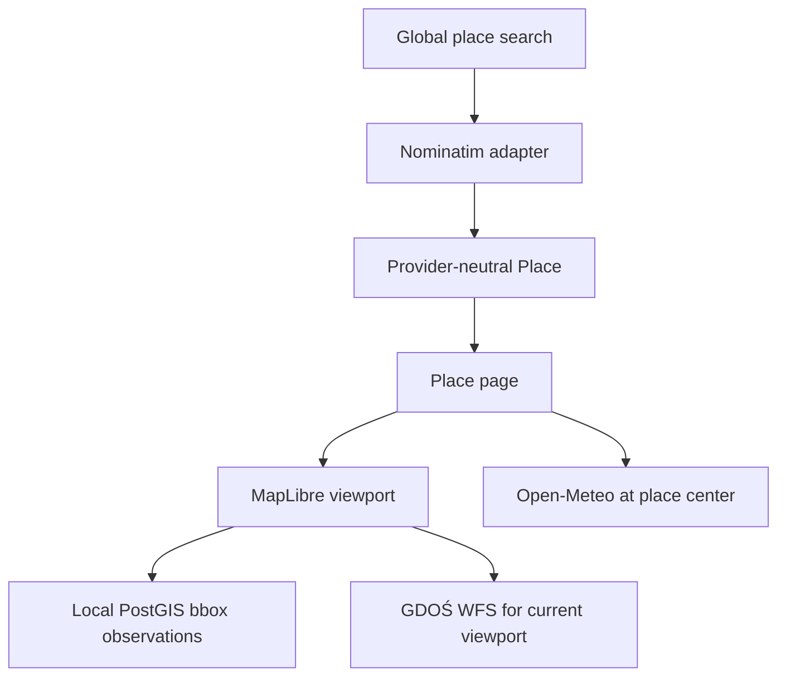

# Nature Lens architecture

> **Status:** deployed V1 architecture
>
> **Scope:** current system boundaries, data flows, operational behavior, and deliberate trade-offs

Nature Lens is a Poland-focused application built around two questions:

1. **Species → where and when was it observed in Poland?**
2. **Place → what nature data and observations are available here?**

This document describes the implemented V1. Future integrations are listed separately and are not shown as current components.

## Current architecture

Nature Lens is a modular monolith with one web application, one API application, one PostgreSQL/PostGIS database, and provider adapters for the external sources used by V1.



### Deployment boundaries

- **Vercel** runs the Next.js application from `web/`.
- **Render** builds `api/Dockerfile` and runs the NestJS API as a non-root Node.js process.
- **Supabase** provides PostgreSQL and PostGIS. Database migrations run separately from API startup.
- External providers remain outside the availability and release boundaries of Nature Lens.

The frontend primarily talks to the Nature Lens API. Provider orchestration, provider limits, normalization, persistence, and error translation belong to the backend.

### Health boundaries

`GET /api/health` is the NestJS process liveness check. It does not query PostgreSQL and remains the Docker health-check target. `GET /api/health/ready` is the external readiness check: it executes `SELECT 1` through the existing `DatabaseService` and returns HTTP 503 when that query fails.

The intended UptimeRobot monitor targets readiness every five minutes so one lightweight request verifies both the running Render API and its Supabase connection. Readiness deliberately excludes schema, migration, PostGIS, domain-table, cache, and external-provider checks.

## System boundaries

### Next.js web

The frontend uses Next.js App Router, React Server Components by default, and small Client Components for browser-only interaction such as MapLibre, map movement, retry controls, and local UI state.

Server-rendered routes provide the initial page structure and data. Independent Suspense and error boundaries keep species observations, weather, and protected areas from turning one provider failure into a whole-page failure.

The web application consumes public Nature Lens DTOs. Network responses are treated as untrusted and validated at runtime with Zod before they reach rendering logic. Rendered map features are validated again, flattened to safe scalar properties, and shown in popups built with DOM APIs rather than HTML interpolation.

### NestJS API

The API is a modular monolith. Its current product modules cover species, places, weather, and protected areas, with shared modules for the database, external HTTP, request protection, provider errors, and logging.

The normal request path is:

```text
controller
    ↓
application service
    ↓
repository and/or provider capability
    ↓
PostgreSQL/PostGIS and/or external provider
```

Controllers own HTTP parsing and response boundaries. Application services own use-case decisions. SQL and provider details stay behind explicit persistence and integration boundaries.

### PostgreSQL and PostGIS

PostgreSQL stores application-owned species identities, provider mappings, normalized observations, exact provider-page synchronization state, and freshness metadata. PostGIS stores public observation points as WGS84 `geometry(Point, 4326)` values and executes viewport bounding-box queries.

The API uses the low-level `pg` driver. This keeps transactions and spatial SQL visible and avoids introducing an ORM or generic repository abstraction without a demonstrated need.

### Provider adapters

Each adapter owns:

- provider endpoints and request parameters;
- provider-specific throttling requirements;
- runtime validation of the external payload received as `unknown`;
- translation of transport and contract failures;
- mapping into small provider-neutral integration types.

Application services depend on capabilities such as species search, taxon matching, observation retrieval, place search, weather, or protected-area lookup. They do not depend on raw provider payloads.

## Species flow

### Search and identity resolution



iNaturalist supplies the current search capability. A GBIF mapping is linked only when the match is exact, high-confidence, rank-compatible, and consistent with the normalized queried name. Scientific-name equality by itself never merges application species.

Species have application-owned `bigint` identities represented as strings in public JSON. Provider mappings are written transactionally and protected by deterministic advisory locks so concurrent resolution cannot create duplicate identities or silently reassign a mapping.

### Detail, synchronization, map, and seasonality



Observation synchronization is provider-page based and on demand. Fresh exact pages avoid provider calls. Stale pages are refreshed; a controlled provider failure may fall back to usable persisted data. Concurrent refreshes for the same species, provider, page, and page size share one complete in-process operation through provider fetch, persistence, metadata replacement, and final read.

Map and seasonality reads never contact providers. They operate only on observations already synchronized into PostgreSQL.

## Place flow



Place identity is an opaque deterministic value derived from the `osm` namespace, `osm_type`, and `osm_id`. Display labels, slugs, provider classifications, and Nominatim `place_id` do not participate in identity. Places are not currently persisted.

Every place has a provider-supplied WGS84 center. Reliable way and relation bounding boxes are preserved for initial map fitting; node bounding boxes are not exposed because they are provider-guessed display hints. Observation queries always follow the actual MapLibre viewport rather than treating the provider extent as a legal or administrative boundary.

The three data sections are intentionally independent:

- biodiversity reads locally synchronized observations from PostGIS;
- weather fetches the Open-Meteo model cell at the place center;
- protected areas fetch GDOŚ geometry for the visible viewport only while the layer is enabled.

One failure does not remove the other sections or the place header.

## Provider-neutral contracts and validation

The same boundary rule applies in both directions:

```text
external JSON
    ↓ validate at provider adapter
small integration type
    ↓ normalize
Nature Lens model
    ↓ expose through public API
public JSON
    ↓ validate in Next.js
rendered UI
```

Only provider fields required by current behavior are modeled. Provider provenance remains available after normalization, including record links, independently supplied license information, dataset identity, and publisher metadata where available.

Provider failures are translated into a stable application taxonomy. Raw provider payloads, validation details, URLs with queries, credentials, and transport internals are not returned to the frontend or emitted into normal logs.

## Observation identity and conservative deduplication

Provider records remain separate database rows with provider-scoped unique identifiers. Nature Lens groups records only when exact canonical identity evidence exists; similar coordinates, dates, names, or positional accuracy are never sufficient.

V1 recognizes one cross-provider relationship: a GBIF record can share an iNaturalist observation identity only when it belongs to the official iNaturalist GBIF dataset and its `occurrenceID` exactly matches the canonical iNaturalist observation URL.

The direct iNaturalist row is the representative of that group. Representative selection happens before spatial filtering and is shared by maps and seasonality. This means a GBIF copy cannot reintroduce a public coordinate when the representative iNaturalist observation has no public point. Every grouped result still retains all provider links and provenance.

Map limits, truncation metadata, totals, clusters, and temporal aggregation describe deduplicated groups rather than raw provider rows.

## Spatial queries and dataset scope

Species and place maps request bounded WGS84 bounding boxes. PostGIS selects representative public points that intersect the viewport, including its boundary, and returns bounded GeoJSON in deterministic recency order.

The all-species place query calculates exact observation and species totals across the full bbox before independently limiting map features and the ranked species list.

Spatial and seasonality responses explicitly describe a locally synchronized dataset. `datasetScope: "locally-synchronized"` means:

- no external provider was queried for that read;
- only records synchronized by previous product use are included;
- missing results do not prove absence;
- counts and seasonal distributions do not represent complete provider coverage or even observation effort.

A point inside a viewport bbox means only that the public observation coordinate intersects that rectangular query. It does not establish that a species definitely occurs throughout a named place, protected area, ecological boundary, or legal/administrative unit.

## Caching, freshness, and single-flight behavior

Caching is specific to each use case rather than hidden behind one generic cache.

| Data                          | Storage                           | Default freshness            | Failure behavior                                                      |
| ----------------------------- | --------------------------------- | ---------------------------- | --------------------------------------------------------------------- |
| Observation pages             | PostgreSQL page metadata and rows | 1 hour                       | Serve usable stale persisted data after a controlled provider failure |
| Place search/lookup           | Bounded process-local cache       | 10 minutes                   | Do not invent results when the provider is unavailable                |
| Current weather               | Bounded process-local cache       | 5 minutes                    | Do not hide provider failure behind expired weather                   |
| Protected areas               | Live request while enabled        | None                         | Preserve other place sections and show a layer-local failure          |
| Spatial and seasonality reads | PostgreSQL/PostGIS                | Current local database state | Never contact providers                                               |

Observation and weather refreshes use process-local single-flight registries. Nominatim uses one process-wide request queue and bounded caching. These controls reduce duplicate work in the current single-process deployment but do not coordinate multiple API replicas.

Redis is deliberately absent from V1. A distributed cache or shared coordination mechanism would add operational complexity without solving a demonstrated current bottleneck.

## External HTTP resilience

One backend HTTP client provides JSON `GET`, provider labels, per-attempt timeouts, bounded retry with jitter, categorized failures, and attempt-aware structured logs.

iNaturalist, GBIF, Open-Meteo, and GDOŚ use at most two attempts for network errors, timeouts, and HTTP 502/503/504. Nominatim uses one attempt because retrying would conflict with the public service policy. Client errors including 429, HTTP 500, invalid JSON, and contract-validation failures are not retried.

Timeouts are configurable per provider. Defaults are 10 seconds for iNaturalist, GBIF, and Nominatim, 5 seconds for Open-Meteo, and 15 seconds for GDOŚ.

### Public Nominatim constraint

The public Nominatim endpoint is appropriate only for the current low-traffic, submit-based search:

- autocomplete is not used;
- search and lookup share a process-wide maximum of one provider request per second;
- identical in-flight requests are coalesced;
- results visibly attribute OpenStreetMap contributors;
- the service has no availability SLA.

Multiple API replicas or meaningful traffic growth require a different OSM-backed service, a self-hosted instance, or cross-process coordination. Adding replicas without changing this strategy would violate the intended aggregate request limit.

## Partial failure and availability metadata

Provider-backed sections fail independently. A place can retain its map and observation results while weather or protected areas fail. Species synchronization can return usable data when one biodiversity provider is unavailable.

Observation synchronization returns request-scoped provider availability:

- `available` — the requested data is usable; a fresh cache hit does not imply a provider was contacted;
- `stale` — refresh failed, but usable persisted data exists;
- `unavailable` — no usable data exists for that provider in this request.

This metadata is not global provider health, uptime monitoring, or a statement about every provider endpoint. It remains separate from page freshness, response source, local dataset scope, and truncation.

## Request protection

Public inputs are bounded before application work begins:

- trimmed search queries have a maximum length;
- observation pagination has bounded page sizes and result windows;
- map feature and species-list limits are independent and bounded;
- bbox spans are bounded while still allowing the full-Poland viewport;
- configuration is validated before application startup.

Incoming API traffic uses process-local per-IP throttling with a validated baseline and stricter expensive-route overrides. Render sets `TRUST_PROXY=true` so Express uses the trusted platform-provided client address; direct and local deployments leave proxy trust disabled.

CORS permits credential-free browser `GET` requests only from the exact configured `WEB_ORIGIN`.

## Logging and request correlation

Every API request receives a server-generated UUID returned as `X-Request-ID`. An `AsyncLocalStorage` request context adds `requestId` to JSON logs produced during asynchronous controller, service, repository, and provider work. Response completion is logged once with the method, query-free path, status, and latency.

Inbound request IDs are ignored because the system has no trusted propagation policy. Correlation currently covers one API request, not a browser-to-provider distributed trace. There is no external trace collector or global provider-health system in V1.

Use the returned `X-Request-ID` or the `requestId` from an API error log to filter the Render log stream. Operational guidance is in [RUNBOOK.md](RUNBOOK.md).

## Protected-area geometry

GDOŚ WFS responses are runtime-validated and normalized to supported Polygon and MultiPolygon features. Geometry is simplified after validation solely to reduce map-transfer and rendering cost. The tolerance follows viewport span within fixed bounds, and simplified geometry is structurally validated again before exposure.

This is presentation-only geometry. It may be incomplete when the response is truncated, simplification does not promise topology preservation, and the result must not be used for legal, surveying, or authoritative spatial-analysis decisions.

## Nature-data safety

Nature Lens preserves provider privacy and precision restrictions. Private coordinates remain absent, obscured coordinates are not reconstructed, and missing coordinates do not automatically imply obscurity.

Observation date and timestamp precision remain separate. Date-only provider data does not receive an invented time. Seasonality uses the preserved provider calendar date and reports records without one as undated.

Product wording treats records as observations:

> This species has been observed in this area.

It does not claim guaranteed current presence.

## Deployment and schema changes

The API image uses the repository-pinned Node.js and pnpm versions. Build dependencies remain in intermediate Docker stages; the runtime image contains only compiled API output and production dependencies and runs as the non-root `node` user.

Production migrations are separate from API startup. `pnpm db:migrate:production` reads only `MIGRATION_DATABASE_URL`, verifies order, applies pending migrations in one transaction, and fails immediately when another migration process holds the advisory lock.

The production release order is migration, API deployment, liveness and readiness verification, web deployment when required, and the fail-fast production smoke check. Production database fixes are forward migrations. Application artifacts may be rolled back only when their schema expectations remain compatible; see [RUNBOOK.md](RUNBOOK.md).

## Testing boundaries

- **Unit tests** cover runtime validation, mapping, normalization, error translation, service decisions, controller behavior, and persistence collaborators.
- **Integration tests** apply real migrations to ephemeral PostgreSQL/PostGIS containers and exercise repository, spatial, synchronization, and HTTP behavior with only external providers stubbed.
- **E2E tests** run the real Next.js application against a deterministic public Nature Lens API fixture for the two primary user journeys. A local empty MapLibre style avoids public tile dependencies.
- **Production smoke** checks the server-rendered Vercel search, Render liveness, direct species search, observation synchronization, and a Poland-bounded PostGIS GeoJSON read. The intended UptimeRobot monitor independently checks database readiness.

The smoke test verifies the normal deployed path but does not prove that a provider was contacted during that run: fresh cache data or stale-if-error fallback may satisfy synchronization safely.

## Important V1 trade-offs

### Modular monolith over services

One API deployment keeps transactions, ownership, debugging, and delivery simple. There is no independent workload that currently justifies distributed deployment or messaging.

### Explicit SQL over ORM abstraction

PostGIS queries, transaction boundaries, and identity locks remain visible. The cost is more hand-written persistence code; the benefit is direct control over the actual data model and spatial behavior.

### Provider-specific persistence and freshness

Observations are persisted because spatial queries, grouping, and historical analysis benefit from local data. Weather and protected areas remain live because persistence would add little current product value. This creates explicit, honest differences in freshness rather than one misleading global policy.

### Process-local coordination

Caches, rate limiting, request queues, and single-flight registries reset on restart and do not coordinate replicas. This is sufficient for the current single-process MVP. Horizontal API scaling requires revisiting these assumptions before adding instances.

### Partial results over all-or-nothing pages

Independent sections and provider metadata preserve useful data during provider failures. The trade-off is more UI and API state: loading, empty, stale, unavailable, truncated, and locally synchronized must remain distinct.

### Conservative identity over aggressive deduplication

Exact canonical evidence leaves some conceptual duplicates separate, but avoids silently merging unrelated observations or exposing coordinates through a weaker copy.

## Current limitations

- Place identities and place data are provider-derived and not persisted independently.
- Spatial totals and seasonality cover only locally synchronized observations.
- Cross-provider observation grouping recognizes only the official GBIF-published iNaturalist relationship.
- Process-local Nominatim limits, incoming throttling, caches, and single-flight behavior assume one API process.
- Exact-origin CORS means Vercel preview deployments can server-render against production but cannot perform browser map refreshes unless the CORS policy changes deliberately.
- Request IDs correlate one API request; there is no distributed tracing or external log aggregation.
- GDOŚ geometry is bounded and display-oriented, not authoritative.

## Planned extensions

The following roadmap items are not part of the current architecture:

- BDL forestry data and a forestry map/place section;
- IMGW official measurement data and source distinction;
- selected OpenStreetMap infrastructure or POI layers;
- scheduled background synchronization if request-driven synchronization becomes insufficient;
- Redis or another distributed coordinator only if measurements or multi-instance deployment justify it.

These extensions should preserve the same boundary rules: validate external data, normalize into application-owned contracts, add persistence only where it creates value, and introduce infrastructure only for a concrete problem.

## Explicit non-goals for V1

V1 does not contain microservices, Redis, message queues, background workers, Kubernetes, GraphQL, complex authentication, a custom map server, or a generic GIS platform. These are not forbidden; they have not earned their operational cost.

## Documentation model

- [README.md](README.md) explains what the project does and how to run it.
- [ARCHITECTURE.md](ARCHITECTURE.md) records current boundaries and decisions.
- [RUNBOOK.md](RUNBOOK.md) describes production diagnosis and recovery.
- [PROJECT_STATE.md](PROJECT_STATE.md) is the rolling implementation snapshot.
- [IMPLEMENTATION_PLAN.md](IMPLEMENTATION_PLAN.md) defines current and future steps.

The guiding rule is to build the smallest coherent product slice, measure the next real limitation, and add complexity only when that limitation justifies it.
