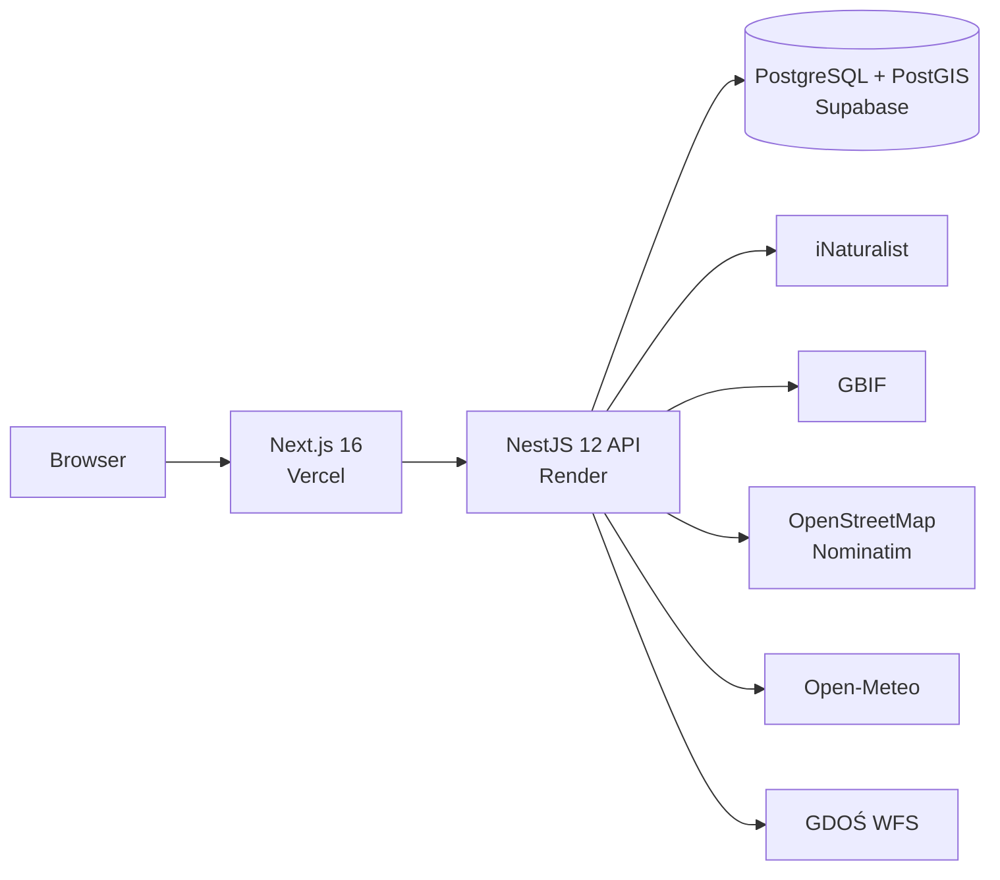

<div align="center">

# 🌲 Nature Lens

### Explore real biodiversity and environmental data across Poland.

[Production web](https://nature-lens-poland.vercel.app) · [Production API health](https://nature-lens-api.onrender.com/api/health)

</div>

---

## 🌿 What Nature Lens does

Nature Lens combines public nature data behind one application-owned API and presents it through two product flows.

### 🦌 Species → where and when was it observed?

1. Search for a species by common or scientific name.
2. Open its application-owned species page.
3. Synchronize real observations from iNaturalist and GBIF.
4. Explore locally stored, deduplicated observations on a MapLibre map.
5. Review observation seasonality by month and year.

### 🗺️ Place → what nature data is available here?

1. Search for a Polish place through OpenStreetMap Nominatim.
2. Open a place page centered on the provider location or extent.
3. Explore locally synchronized biodiversity observations in the current map viewport.
4. See current Open-Meteo model conditions for the place center.
5. Toggle display-simplified GDOŚ protected-area boundaries.

Nature Lens reports observations, not guaranteed species presence. It preserves provider privacy restrictions and never attempts to reconstruct obscured or hidden coordinates.

## 🏗️ Current V1 architecture

Nature Lens is a pnpm workspace with a Next.js frontend and a NestJS modular-monolith API. External provider payloads are validated and normalized at adapter boundaries before they enter application logic.



The frontend consumes provider-neutral Nature Lens contracts rather than raw provider responses. PostgreSQL/PostGIS stores species and normalized observations where persistence, synchronization, deduplication, seasonality, and spatial querying add product value. Place search, weather, and protected areas are fetched live with provider-specific caching and resilience policies.

For boundaries, data flows, failure behavior, and trade-offs, see [ARCHITECTURE.md](ARCHITECTURE.md).

## 🧱 Technology stack

| Area       | Technology                                                |
| ---------- | --------------------------------------------------------- |
| Web        | Next.js 16, React 19, TypeScript, Tailwind CSS, shadcn/ui |
| API        | Node.js, NestJS 12, REST, Zod                             |
| Data       | PostgreSQL, PostGIS, Supabase                             |
| Maps       | MapLibre, GeoJSON, viewport-based spatial queries         |
| Deployment | Vercel, Render, Supabase                                  |
| Testing    | Vitest, Testcontainers, Playwright, GitHub Actions        |

## 📦 Repository structure

```text
nature-lens/
├── web/                    # Next.js App Router application
├── api/                    # NestJS API
│   ├── migrations/         # Forward database schema history
│   └── test/               # PostgreSQL/PostGIS integration tests
├── scripts/                # Production smoke check
├── .github/workflows/      # CI quality pipeline
├── ARCHITECTURE.md         # Current architecture and trade-offs
├── RUNBOOK.md              # Production diagnosis and recovery
└── PROJECT_STATE.md        # Concise current implementation snapshot
```

## 🚀 Local setup

### ✅ Prerequisites

- Node.js 22.22.3 or newer on the 22.x line, or Node.js 24.15 or newer on the 24.x line
- pnpm 12.4.1, pinned by the root `packageManager` field
- a reachable PostgreSQL database with PostGIS support, such as a development Supabase project
- a Docker-compatible runtime only when running the Testcontainers integration suite

Node.js 23.3.0 is not supported because it cannot load a Nest CLI dependency used by this repository.

### ⚙️ Install and configure

From the repository root:

```bash
pnpm install
cp web/.env.example web/.env.local
cp api/.env.example api/.env
```

Set `DATABASE_URL` in `api/.env` to the development database connection string. Never commit that file or its credentials. The checked-in examples document every required variable and safe default.

Apply the schema:

```bash
pnpm db:migrate
```

Start the applications in separate terminals:

```bash
pnpm dev:api
pnpm dev:web
```

The web application defaults to <http://localhost:3000>. The API defaults to <http://localhost:3001> and exposes `GET /api/health`.

### 🔐 Important local configuration

- `NEXT_PUBLIC_API_BASE_URL` is the public API origin without `/api`; it is embedded in the browser bundle and must not contain a secret.
- `NEXT_PUBLIC_MAP_STYLE_URL` is optional and defaults to OpenFreeMap Liberty.
- `WEB_ORIGIN` is one exact allowed web origin without a path.
- `DATABASE_URL` and production-only `MIGRATION_DATABASE_URL` are server-side secrets.
- `TRUST_PROXY` remains `false` locally and is enabled only behind the trusted Render proxy.

The API validates its configuration before startup. See [api/.env.example](api/.env.example) and [web/.env.example](web/.env.example) for provider timeouts, freshness windows, request limits, and endpoint overrides.

## 🧪 Development and quality commands

Run commands from the repository root.

| Command                 | Purpose                                                        |
| ----------------------- | -------------------------------------------------------------- |
| `pnpm format:check`     | Check repository formatting                                    |
| `pnpm lint`             | Lint the web, API, and scripts                                 |
| `pnpm typecheck`        | Type-check both applications                                   |
| `pnpm test`             | Run API and web unit tests                                     |
| `pnpm test:integration` | Run PostgreSQL/PostGIS integration tests in Testcontainers     |
| `pnpm test:e2e`         | Run the two primary browser journeys with Playwright           |
| `pnpm build`            | Build the web and API applications                             |
| `pnpm smoke:production` | Check the deployed web, API, synchronization, and PostGIS flow |

Install the Playwright Chromium runtime before the first local E2E run:

```bash
pnpm --filter web exec playwright install chromium
```

GitHub Actions runs frozen installation, formatting, linting, type-checking, unit tests, integration tests, E2E tests, and both builds for pull requests and pushes to `main`.

## 🐘 Database migrations

Local migrations read `DATABASE_URL` from `api/.env`:

```bash
pnpm db:migrate
pnpm db:migrate:create migration-name
pnpm db:migrate:down
```

Production migrations are deliberately separate from API startup and forward-only:

```bash
MIGRATION_DATABASE_URL=... pnpm db:migrate:production
```

`MIGRATION_DATABASE_URL` must come from the process environment or a deployment secret store. The production command checks migration order, applies pending migrations in one transaction, and uses an advisory lock to reject concurrent migration runs. Correct production schema problems with a new forward migration rather than `db:migrate:down`.

## ☁️ Production deployment

The production topology is:

- `web/` on Vercel;
- the API container from `api/Dockerfile` on Render;
- PostgreSQL/PostGIS on Supabase.

Deploy database and API changes in this order:

1. Install dependencies from the frozen lockfile.
2. Run `pnpm db:migrate:production` with the migration-only connection secret.
3. Deploy or restart the Render API with its runtime `DATABASE_URL`.
4. Verify `GET /api/health`.
5. Deploy the Vercel web application when its code or build-time environment changes.
6. Run `pnpm smoke:production`.

Environment changes apply only to new deployments. `WEB_ORIGIN` on Render must exactly match the production Vercel origin, and `NEXT_PUBLIC_API_BASE_URL` on Vercel must point to the Render origin without `/api`.

For symptoms, log correlation, safe recovery, rollback, and forward-fix guidance, see [RUNBOOK.md](RUNBOOK.md).

## 🛡️ Data scope and safety

- Observation maps, bbox totals, species summaries, and seasonality use only records already synchronized into the Nature Lens database. They do not represent complete provider coverage.
- Viewport results mean that an observation point falls inside the requested bounding box. They do not prove that a species occupies a legal, ecological, or administrative area.
- Cross-provider grouping is intentionally conservative and requires exact canonical identity evidence.
- GDOŚ geometry is simplified only for display and is not suitable for legal decisions.
- Weather describes the Open-Meteo model cell at the place center, not an entire place extent.

## 🌱 Planned post-V1 extensions

BDL forestry data, IMGW official measurements, additional OpenStreetMap layers, background synchronization, and distributed infrastructure remain post-V1 possibilities. They are not part of the current architecture and should be introduced only for a concrete product or operational need.

## 📚 Project documentation

- [ARCHITECTURE.md](ARCHITECTURE.md) — current system boundaries, data flows, and important trade-offs.
- [RUNBOOK.md](RUNBOOK.md) — production diagnosis and safe recovery actions.
- [PROJECT_STATE.md](PROJECT_STATE.md) — current implementation snapshot and next implementation step.
- [IMPLEMENTATION_PLAN.md](IMPLEMENTATION_PLAN.md) — incremental roadmap, including post-V1 work.
- [AGENTS.md](AGENTS.md) — repository working rules for coding agents.

---

<div align="center">

**Real nature data. Clear engineering decisions. One coherent interface.**

</div>
